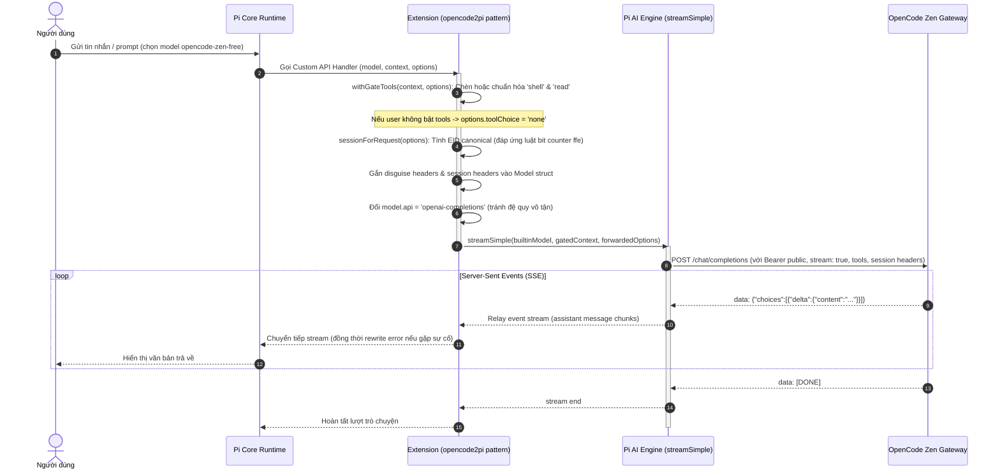

# Báo cáo Nghiên cứu: Phân tích hai Extension tham khảo để thiết kế Extension kết nối OpenCode Zen Free Models cho Pi

> **Ngày thực hiện**: 2026-10-15  
> **Trạng thái**: Đã khảo sát và đối chiếu mã nguồn thực tế (Ground-Truth Verified)  
> **Repository tham khảo**:  
> - `references/opencode-free` (commit `d713fb7`, MIT License)  
> - `references/opencode2pi` (`v0.3.5`, commit `fc9297e`, MIT License)

---

## ⚠️ Đính chính sau khi triển khai (2026-10-15)

Tài liệu này được viết **trước khi** đối chiếu với host thật. Ba nhận định dưới đây đã bị bác bỏ bằng cách đọc mã nguồn `@earendil-works/pi-ai@1.2.0` và probe trực tiếp Gateway. Phần nào còn nhắc `registerCustomApi` hoặc provider `opencode-zen-free` cần đọc với thái độ dè dặt.

| Nhận định trong tài liệu | Thực tế |
| :--- | :--- |
| `registerCustomApi` là seam chuẩn của Pi | **Sai.** Không tồn tại trong `pi-ai@1.2.0`. Seam đúng là `registerApiProvider({api, stream, streamSimple}, sourceId)` từ `pi-ai/compat` (mục 3.1, 5.1 README). |
| Pi gọi model qua `context.tools` | **Sai.** Host truyền `TranscriptContext` chỉ có `messages`; tool nằm ở system message (`toolsAdded`/`toolsRemoved`). Đọc `context.tools` luôn ra `undefined` → mất toàn bộ tool calling (mục 5.2 README). |
| Chỉ cần `shell`/`read` nguyên văn là qua gate | **Không đủ.** Gateway còn trả 403 `FreeTierError` khi: `stream: false`, không kèm tool nào, có header `x-opencode-request` (bất kể giá trị), hoặc tool `bash`/`shell` mang description rút gọn (bảng probe ở mục 5.3 README). |

Tên provider cũng đã đổi: extension này đăng ký **`zen-free`** (không phải `opencode-zen-free` — đó là provider của package khác `pi-opencode-direct`, nay đã gỡ).

---

## 1. Phát hiện cốt lõi về bản chất hệ sinh thái Pi & OpenCode Zen Gateway

Qua khảo sát trực tiếp mã nguồn, cả hai dự án đều giải quyết bài toán: **Làm sao để Pi (`omp` / `@oh-my-pi/pi-coding-agent`) gọi được các model miễn phí của OpenCode Zen mà không cần API key trả phí, không cần tài khoản, và không cần cài đặt CLI gốc của OpenCode.**

### Bản chất "Shape Gate" (Cánh cổng kiểm tra hình thái request) của OpenCode Zen:
OpenCode Zen (`https://opencode.ai/zen/v1` hoặc `https://opencode.ai/inference/v1`) áp dụng cơ chế bảo vệ kênh miễn phí bằng **kiểm tra hình thái (request-shape check) thay vì chứng thực tài khoản (credential check)**. Bất kỳ request nào thiếu một trong các điều kiện này đều bị Gateway trả về lỗi `HTTP 403 FreeTierError` (*"OpenCode's free tier can only be used from within OpenCode"*):

1. **Authorization Token**: Phải gửi Header `Authorization: Bearer public` (`public` là chuỗi cố định công khai, không phải secret).
2. **Client Identifiers & Spoofing Header**:
   - `user-agent`: Phải có định dạng `opencode/<version>` (ví dụ: `opencode/latest/2.0.29/cli` hoặc `opencode/1.18.35`).
   - `x-opencode-client`: Bắt buộc là `cli`. Nếu gửi `pi` (nhãn mặc định của Pi), Gateway lập tức trả về 403.
   - `x-opencode-project`: Chuỗi hex SHA-256 (40 ký tự) đại diện cho project.
3. **Session ID & Request ID (Định dạng EID đặc thù)**:
   - Gateway từ chối UUID thông thường. Định dạng bắt buộc: `^ses_[0-9a-f]{12}[0-9A-Za-z]{14}$`.
   - **Quy tắc kiểm tra bit (phát hiện tháng 10/2026)**: 12 ký tự hex không phải ngẫu nhiên mà 12 bit thấp nhất (low 12 bits) sau khi bitwise-NOT được giải mã thành một bộ đếm milli-giây trong khoảng `[1, 63]` (tương ứng trên đường truyền hex kết thúc bằng dải `[0xFC0, 0xFFF]`, ví dụ kết thúc bằng `...ffe`).
   - Header `x-opencode-request` (tiền tố `msg_...`) phải được sinh mới trên từng lượt request.
4. **Body mang hình thái Agent (Agent-shaped Body)**:
   - Bắt buộc phải có `stream: true`. Nếu gửi `stream: false` sẽ bị 403.
   - Mảng `tools` bắt buộc phải chứa các công cụ agent (ở `opencode-free` là `read` và `bash`; ở `opencode2pi` bản cập nhật 15/10/2026 yêu cầu `shell` và `read` kèm toàn bộ definition JSON nguyên bản của OpenCode). Nếu gửi request chat thông thường không có `tools`, Gateway sẽ chặn với mã 403.

---

## 2. Tổng quan kiến trúc từng dự án

### 2.1 Dự án 1: `opencode-free` (verdulife)

- **Cấu trúc thư mục**:
  ```text
  opencode-free/
  ├── package.json              (type: "module", pi.extensions: ["./extensions"])
  ├── extensions/
  │   └── opencode-free.ts      (1,161 dòng TypeScript nguyên khối)
  └── tests/
      ├── fingerprint.test.ts   (Test sinh EID, regex, rewrite headers)
      ├── hooks.test.ts         (Test hook Pi: session_before_compact, session_before_tree)
      └── summarization.test.ts (Test SSE parser, file tracking, serialization)
  ```
- **Chiến lược tiếp cận**:
  - Đăng ký provider chuẩn qua `pi.registerProvider("opencode", { api: "openai-completions", ... })`.
  - Dùng hook `before_provider_headers` để can thiệp vào request chuẩn của Pi: ghi đè `x-opencode-client: pi` thành `cli`, gắn EID session và sinh mới EID message.
  - **Tự thực thi Context Compaction & Branch Summary**: Do tính năng tóm tắt nội bộ của Pi (`session.compact`, `navigateTree`) gửi request không có `tools` và không có `stream: true` (dẫn tới bị Zen chặn 403), extension hook vào `session_before_compact` và `session_before_tree`, tự dùng `fetch()` gọi Gateway với đầy đủ `tools: ["read", "bash"]` và `stream: true`, đọc SSE, rồi trả kết quả tóm tắt lại cho Pi.
- **Hạn chế lớn**:
  - Toàn bộ 1,161 dòng code nằm chung 1 file (`opencode-free.ts`).
  - Đường dẫn cache dùng `${process.env.HOME}/.cache/opencode-pi` gây lỗi crash/không lưu được trên môi trường Windows (`process.env.HOME` là `undefined`).
  - Khi khởi động, extension tự động gọi fetch ngầm (`refreshInBackground`) làm ô nhiễm các mock trong unit test.

### 2.2 Dự án 2: `opencode2pi` (FanchangWang)

- **Cấu trúc thư mục**:
  ```text
  opencode2pi/
  ├── package.json              (pi.extensions: ["./src/index.ts"])
  ├── src/
  │   ├── index.ts              (Entry point: applyProvider, withGateTools, registerCustomApi)
  │   ├── session.ts            (Thuật toán sinh Session ID & descendingTimePart)
  │   ├── tools.ts              (Khai báo schema chuẩn của shell và read)
  │   ├── discovery.ts          (Bậc thang khám phá model 3 cấp: S1 Live, S2 metadata, S3 seed)
  │   ├── seed.ts               (Danh sách model tĩnh dự phòng & danh sách denylist)
  │   ├── metadata.ts           (Chuẩn hóa schema model từ models.dev, giới hạn token)
  │   ├── errors.ts             (Phân loại mã lỗi Gateway: RegionError, FreeTierError, 429...)
  │   ├── health.ts             (Cơ chế đo kiểm sức khỏe model, chống nhiễu flapping)
  │   ├── filters.ts            (Lọc ẩn model theo cấu hình người dùng)
  │   ├── gate.ts               (Định dạng request chuẩn dùng chung cho Doctor và Probe)
  │   ├── doctor.ts             (Lệnh tự kiểm tra xem Gateway có đổi shape không)
  │   └── commands.ts           (Lệnh /opencode2pi: doctor, status, probe, filter)
  └── test/
      └── opencode2pi.test.ts   (48 unit test chạy với bun test)
  ```
- **Chiến lược tiếp cận**:
  - Không dựa vào `before_provider_headers` để ghi đè header.
  - Khám phá ra rằng `pi.registerProvider` bỏ qua các hook `onPayload` hay `prepareRequest`. Điểm tích hợp (seam) thực sự hoạt động là **`registerCustomApi(API_ID, ...)`** từ thư viện `@earendil-works/pi-ai`.
  - Trong handler của custom API, extension biến đổi cấu trúc context bằng `withGateTools()` (nâng cấp hoặc bổ sung `shell` và `read`, nếu user không dùng tool thì gán `options.toolChoice = 'none'`), gắn session header vào model, rồi ủy thác ngược lại cho hàm `streamSimple` nguyên bản của Pi bằng cách đổi `model.api = 'openai-completions'`.
  - **Không can thiệp vào compaction**: Ủy thác việc tóm tắt cho Pi xử lý như các model thông thường (nhưng nếu Pi gọi tóm tắt qua custom API, các tool bắt buộc vẫn được tự động bổ sung nên không bị 403).
  - Có bộ công cụ chẩn đoán chuyên sâu (`doctor`, `status`, `probe`) và cơ chế đo kiểm phân loại lỗi rõ ràng.

---

## 3. Bảng so sánh chuyên sâu giữa hai dự án

| Tiêu chí | `opencode-free` | `opencode2pi` | Nhận định & Đánh giá |
| :--- | :--- | :--- | :--- |
| **Kiến trúc mã nguồn** | Nguyên khối (Monolithic - 1 file TS ~1,160 dòng). | Module hóa cao (11 file chia theo miền chức năng). | `opencode2pi` có kiến trúc vượt trội, dễ bảo trì và mở rộng. |
| **Điểm cắm vào Pi (API Seam)** | `pi.registerProvider` + `before_provider_headers` + `session_before_compact`. | `registerCustomApi` từ `@earendil-works/pi-ai` + `pi.registerProvider`. | Seam của `opencode2pi` sạch hơn nhiều, can thiệp đúng ở tầng stream abstraction của Pi. |
| **Xử lý Session ID (EID)** | Sinh ngẫu nhiên theo công thức EID cơ bản (`Date.now() << 12 \| counter`). | Thuật toán `descendingTimePart` đáp ứng luật kiểm tra bit counter `[1, 63]` (kết thúc hex `ffe`). | `opencode2pi` cập nhật đúng theo logic Gateway mới nhất (10/2026). `opencode-free` có nguy cơ bị 403 tới ~98.5% do chưa fix rule này. |
| **Bổ sung Tools (Gate Condition)** | Chèn tool dạng stub tối giản `["read", "bash"]` trong request summarization. | Chèn tool schema đầy đủ chuẩn của OpenCode `["shell", "read"]`, đặt `toolChoice: 'none'` nếu request gốc không dùng tool. | `opencode2pi` an toàn hơn vì Gateway đã bắt đầu kiểm tra schema định nghĩa của tool thay vì chỉ kiểm tra tên. |
| **Quản lý danh sách Model** | 3 lớp: Fallback seed $\rightarrow$ File cache $\rightarrow$ Fetch `models.opencode.ai/api.json`. | 3 tầng bậc thang (S1: Live Zen API $\rightarrow$ S2: `models.dev` metadata $\rightarrow$ S3: Static Seed). Có cơ chế Denylist các model đã chết. | `opencode2pi` xử lý metadata chính xác hơn (ngăn việc model bị rơi về default 128k/16k token của Pi). |
| **Cơ chế Context Summarization** | Viết lại toàn bộ luồng compaction và branch summary nội bộ của Pi (dùng `fetch` riêng). | Để Pi tự tóm tắt thông qua pipeline `registerCustomApi` đã được bảo vệ bởi `withGateTools`. | `opencode-free` giải quyết được triệt để compaction nếu không dùng `registerCustomApi`, nhưng trùng lặp logic lớn. Cách của `opencode2pi` tự nhiên hơn. |
| **Xử lý lỗi & Chẩn đoán** | Bắt lỗi cơ bản, thông báo qua `ctx.ui.notify`. | Module `errors.ts` phân loại: `REGION_BLOCKED`, `SHAPE_REJECTED`, `MODEL_GONE`, `RATE_LIMIT`. Có lệnh `/opencode2pi doctor` để kiểm tra cổng. | `opencode2pi` hỗ trợ trải nghiệm người dùng và gỡ lỗi tốt hơn nhiều. |
| **Tính tương thích hệ điều hành** | Dính lỗi Windows do gọi cứng `process.env.HOME`. | Tương thích đa nền tảng (dùng `os.tmpdir()` chuẩn). | `opencode2pi` an toàn hơn khi chạy trên Windows. |
| **Kiểm thử (Test Suite)** | 43 test (Node 22 native test), có 3 test fail do xung đột môi trường Windows/unmocked fetch. | 48 test (Bun test) bao quát từ mapping capability, session bit logic, error taxonomy, health probe. | Bộ test của `opencode2pi` được thiết kế chặt chẽ và ổn định hơn. |

---

## 4. Luồng Request hoàn chỉnh từng bước



### Các bước cụ thể:
1. **Lựa chọn Model**: Người dùng chỉ định model qua `--model opencode-zen-free/<model_id>` hoặc lệnh `/model`.
2. **Khởi tạo Seam**: Pi không gọi trực tiếp HTTP mà chuyển tới callback đã đăng ký qua `registerCustomApi`.
3. **Chuẩn hóa Request (Gate Shaping)**:
   - `withGateTools()` kiểm tra: Nếu mảng `tools` thiếu `shell` hoặc `read`, tự động bổ sung schema JSON chính thức.
   - Nếu lượt chat là dạng bare completion (không dùng tools), gán `options.toolChoice = 'none'` để model không cố gọi tool rác.
4. **Định danh Session & Fingerprint**:
   - Chuyển Session UUID của Pi thành dạng Canonical EID thông qua băm SHA-256 kết hợp dịch bit `descendingTimePart`, đảm bảo 12 bit thấp kết thúc bằng `0xffe` để vượt qua bộ kiểm tra clock.
   - Gắn các header `user-agent`, `x-opencode-client: cli`, `x-opencode-project`.
5. **Ủy thác cho Pi Engine**:
   - Trả `model.api` về `'openai-completions'`, gọi `streamSimple()`. Toàn bộ việc kết nối HTTP, đọc SSE, ghép chunk do nhân của Pi phụ trách mà extension không cần viết lại parser socket hay SSE.
6. **Bắt và phân loại lỗi**:
   - Nếu Gateway trả lỗi, intercept stream event để phân loại mã lỗi chính xác (ví dụ: `RegionError` báo cho user biết do IP bị chặn vùng thay vì báo sai API key).

---

## 5. Những điểm dễ gãy khi Gateway thay đổi (Fragility Points)

| Điểm phụ thuộc | Mức độ nguy cơ | Dấu hiệu nhận biết khi bị gãy | Phương án dự phòng |
| :--- | :--- | :--- | :--- |
| **Đổi Endpoint** | Trung bình | HTTP 404 / 403 trên diện rộng (từng xảy ra khi chuyển từ `/zen/v1` sang `/inference/v1` ngày 14/10/2026). | Cho phép ghi đè URL qua config hoặc cập nhật danh sách base URL tự động. |
| **Thắt chặt luật kiểm tra Session ID** | Rất cao | HTTP 403 `FreeTierError` hoặc `MissingSessionID` hàng loạt. | Tách riêng module `session.ts`, có sẵn script `doctor` kiểm tra probe để phát hiện ngay khi upstream đổi format. |
| **Kiểm tra chữ ký số / Challenge-Response** | Nghiêm trọng | Gateway trả về mã thách thức cryptographic hoặc Cloudflare Turnstile bot detection. | Khó bypass bằng HTTP thuần; lúc này bắt buộc phải yêu cầu user nhập API token chính thức của OpenCode. |
| **Thay đổi Tool định danh** | Trung bình | 403 `FreeTierError` khi gửi tool cũ (ví dụ: chuyển từ `bash` sang `shell`). | Quản lý schema tool tập trung trong `tools.ts` để cập nhật nhanh chóng. |
| **Xóa bỏ các model miễn phí quen thuộc** | Thấp | 401 `ModelError` (*"model is unavailable"*). | Sử dụng cơ chế 3 tầng discovery: tự động cập nhật danh sách model từ API thay vì ghim cứng danh sách tĩnh. |

---

## 6. Rủi ro bảo mật và Biện pháp giảm thiểu

1. **Rủi ro rò rỉ mã nguồn/ngữ cảnh tới bên thứ ba**:
   - *Nguy cơ*: Vì đây là kênh miễn phí công khai không có hợp đồng cam kết bảo mật dữ liệu doanh nghiệp (Zero Data Retention), việc gửi mã nguồn nhạy cảm lên Gateway có thể tiềm ẩn rủi ro về quyền riêng tư dữ liệu.
   - *Biện pháp*: Bổ sung cảnh báo rõ ràng trong README và câu lệnh `/opencode doctor` để người dùng ý thức không gửi dữ liệu mật.
2. **Nguy cơ chiếm quyền điều khiển đường dẫn tạm (Insecure Temp Files)**:
   - *Nguy cơ*: Trong `opencode2pi`, các file cache được ghi vào thư mục dùng chung `os.tmpdir()/opencode2pi/` có thể bị chiếm dụng hoặc can thiệp trên hệ điều hành Linux nhiều người dùng.
   - *Biện pháp*: Sử dụng thư mục cấu hình riêng biệt của người dùng (`path.join(os.homedir(), ".pi", "opencode-free")`) với quyền truy cập phân quyền rõ ràng (`0700`).
3. **Lỗi đường dẫn trên Windows (`process.env.HOME`)**:
   - *Nguy cơ*: Sử dụng biến môi trường Unix-only khiến extension sinh ra thư mục rác `undefined/.cache/` và không lưu được dữ liệu trên Windows.
   - *Biện pháp*: Luôn dùng `os.homedir()` từ module `node:os`.
4. **Tấn công từ chối dịch vụ cục bộ (Local DoS do Retry bão hòa)**:
   - *Nguy cơ*: Khi bị Gateway chặn mã 429 hoặc 403, việc liên tục retry tự động sẽ khiến IP người dùng bị đưa vào danh sách đen của OpenCode.
   - *Biện pháp*: Tuyệt đối không tự động retry dồn dập khi gặp 403/429; chuyển thẳng lỗi về UI kèm hướng dẫn giảm tải.

---

## 7. Kiến trúc đề xuất cho Extension mới (`pi-opencode-free`)

Thay vì sao chép toàn bộ, kiến trúc mới sẽ chắt lọc **sự gọn gàng, đúng seam tích hợp của `opencode2pi`**, loại bỏ các thành phần rườm rà (giao diện TUI phức tạp, nhiều file rời rạc) để tạo nên một extension **tối giản, minh bạch và tin cậy**.

### 7.1 Cấu trúc mô-đun đề xuất (Tối giản 6 file)

```text
pi-opencode-free/
├── package.json               # Manifest Pi extension, 0 runtime dependency
├── tsconfig.json              # Chuẩn hóa cấu hình TypeScript
├── src/
│   ├── index.ts               # Entry point: Đăng ký Provider & Custom API Seam
│   ├── gate.ts                # Định dạng Session EID (thuật toán bit-counter) & Genuine Tools
│   ├── models.ts              # Quản lý danh sách model (Static Seed + Discovery)
│   ├── errors.ts              # Phân loại lỗi và định dạng thông báo dễ hiểu cho người dùng
│   └── doctor.ts              # Probe kiểm tra sức khỏe Gate độc lập
└── test/
    ├── gate.test.ts           # Test kiểm tra tính hợp lệ của EID và Tool injection
    └── models.test.ts         # Test ánh xạ metadata model và fallback
```

### 7.2 Trách nhiệm cụ thể của từng mô-đun

1. **`src/gate.ts`**:
   - Chịu trách nhiệm toàn bộ về "hình thái request" (Gate Conditions).
   - Hàm `createSessionId(seed)`: Sinh mã session EID đảm bảo 12 bit thấp decode ra counter trong `[1, 63]` (kết thúc hex `ffe`).
   - Hàm `withGateTools(context, options)`: Đảm bảo có `shell` và `read` chuẩn. Nếu request gốc không yêu cầu tool, set `toolChoice: 'none'`.
2. **`src/index.ts`**:
   - Sử dụng `registerCustomApi` từ `@earendil-works/pi-ai` để hook vào luồng request.
   - Gọi `withGateTools`, gắn session headers, chuyển tiếp tới `streamSimple()` của Pi với `model.api = 'openai-completions'`.
   - Đăng ký provider với Pi thông qua `pi.registerProvider()`.
   - Cung cấp lệnh `/opencode doctor` để người dùng tự chẩn đoán.
3. **`src/models.ts`**:
   - Chứa danh sách tĩnh `SEED_MODELS` đã được kiểm chứng hoạt động (ví dụ: `big-pickle`, `mimo-v2.6-flash-free`, `nemotron-3.5-lightning-free`).
   - Hàm `refreshModels()`: Gọi `GET https://opencode.ai/inference/v1/models` và kết hợp models.dev khi có mạng; nếu mất mạng giữ nguyên danh sách cũ.
   - Định dạng model metadata chuẩn dạng phẳng (`contextWindow`, `maxTokens`, `cost: { input: 0, output: 0 }`).
4. **`src/errors.ts`**:
   - Nhận diện các lỗi điển hình từ Gateway: phân biệt rõ ràng giữa `RegionError` (IP bị chặn theo quốc gia) và `FreeTierError` (hình thái request bị sai).
5. **`src/doctor.ts`**:
   - Gửi 1 request probe siêu nhẹ (hủy ngay khi nhận 200) đến Gateway để báo cáo trạng thái: Cổng mở, Bị chặn IP, hay Upstream đã đổi luật kiểm tra.

### 7.3 Chiến lược kiểm thử không gọi API thật

- Sử dụng mock trực tiếp đối tượng `Context` và `SimpleStreamOptions`.
- Kiểm thử đơn vị thuật toán sinh EID: Đảm bảo chuỗi sinh ra luôn khớp regex `EID_PATTERN` và kết thúc bằng dải hex counter quy định.
- Kiểm thử `withGateTools`: Xác nhận nếu đầu vào không có tools, đầu ra luôn được chèn đủ 2 tool chuẩn và `toolChoice` được gán thành `'none'`.
- Kiểm thử phân loại lỗi: Truyền các chuỗi lỗi giả lập (`RegionError`, `FreeTierError`, `rate limit`) và kiểm tra kết quả phân loại mong đợi.

---

## 8. Danh sách câu hỏi cần xác minh thêm

1. **Kiểm tra tính khả dụng hiện tại của Endpoint `/inference/v1` so với `/zen/v1`**:
   - Cần kiểm tra xem hiện tại Gateway còn phản hồi trên `/zen/v1` hay đã chuyển hẳn sang `/inference/v1` đối với các IP tại Việt Nam.
2. **Định dạng công cụ bắt buộc hiện tại**:
   - Liệu Gateway đang yêu cầu cặp `["read", "bash"]` (như trong `opencode-free`) hay `["shell", "read"]` (như bản 15/10/2026 của `opencode2pi`)? Cần chạy probe thực tế một lần để chốt chính xác.
3. **Mức độ hỗ trợ Streaming Reasoning / Thinking Tokens**:
   - Các model như `nemotron` hoặc `big-pickle` có stream phần suy nghĩ (thinking tokens) theo cấu trúc chuẩn OpenAI hay một trường riêng?

---

## 9. Kế hoạch triển khai (Task nhỏ kèm Tiêu chí nghiệm thu)

### Task 1: Thiết lập Project Scaffold & Type Definition
- **Mục tiêu**: Tạo `package.json`, `tsconfig.json`, cấu hình module resolution cho Pi.
- **Tiêu chí nghiệm thu**: `npm run build` hoặc `tsc --noEmit` chạy sạch, không lỗi type.

### Task 2: Hiện thực hóa Mô-đun Gate & Session Identity (`src/gate.ts`)
- **Mục tiêu**: Cài đặt thuật toán sinh EID session theo luật bit counter và hàm chuẩn hóa tool `withGateTools`.
- **Tiêu chí nghiệm thu**: Unit test kiểm tra 100 lần sinh EID đều thỏa mãn `EID_PATTERN` và dải hex `ffe`.

### Task 3: Hiện thực hóa Quản lý Model & Fallback Seed (`src/models.ts`)
- **Mục tiêu**: Định nghĩa danh sách SEED_MODELS với metadata phẳng chuẩn xác (`contextWindow`, `maxTokens`), không dùng cấu trúc lồng `limits`.
- **Tiêu chí nghiệm thu**: Unit test kiểm tra cấu trúc model xuất ra đúng chuẩn của `@earendil-works/pi-ai`.

### Task 4: Hiện thực hóa Tích hợp Custom API Seam (`src/index.ts`)
- **Mục tiêu**: Đăng ký `registerCustomApi`, định tuyến stream và gọi `streamSimple()`.
- **Tiêu chí nghiệm thu**: Kiểm tra mock stream handler chuyển tiếp đầy đủ sự kiện văn bản và không bị đệ quy vòng lặp.

### Task 5: Hiện thực hóa Bộ chẩn đoán Gate Doctor (`src/doctor.ts`)
- **Mục tiêu**: Xây dựng lệnh `/opencode doctor` để kiểm tra kết nối với Gateway.
- **Tiêu chí nghiệm thu**: Lệnh trả về kết quả rõ ràng (Xanh: Gate OK, Đỏ: Gate Changed kèm mã lỗi chi tiết).

---

## 10. Tóm tắt kết quả nghiên cứu (Bằng tiếng Việt dễ hiểu)

Qua việc khảo sát trực tiếp mã nguồn hai repository:

1. **Bản chất hoạt động**: Cả hai extension đều không dùng API key cá nhân, mà dùng cơ chế giả lập "hình thái request" giống như OpenCode CLI chính thức (mang token `Bearer public`, User-Agent đặc thù, Session ID mã hóa theo định dạng EID có quy tắc kiểm tra bit thời gian, và bắt buộc phải đính kèm các công cụ agent như `shell`/`read` cùng chế độ streaming).
2. **So sánh hai bên**:
   - `opencode-free` viết dồn toàn bộ vào một file 1,160 dòng, tự viết lại luồng tóm tắt lịch sử (compaction) nhưng chưa cập nhật quy tắc bit counter mới của Gateway và dính lỗi không chạy được trên Windows.
   - `opencode2pi` phát hiện ra điểm tích hợp chuẩn nhất của Pi là `registerCustomApi`, cập nhật đầy đủ các thay đổi mới nhất của Gateway (tính đến 15/10/2026), phân loại lỗi thông minh và tổ chức mã nguồn bài bản.
3. **Định hướng cho extension mới của chúng ta**:
   - Kế thừa giải pháp kỹ thuật cốt lõi đúng đắn của `opencode2pi` (dùng `registerCustomApi` và thuật toán sinh EID chuẩn bit-counter).
   - Tối giản kiến trúc xuống còn 5-6 file rõ ràng, loại bỏ các giao diện phức tạp thừa thãi để dễ bảo trì, dễ kiểm thử tự động, và đảm bảo chạy mượt mà trên môi trường Windows lẫn Linux.
